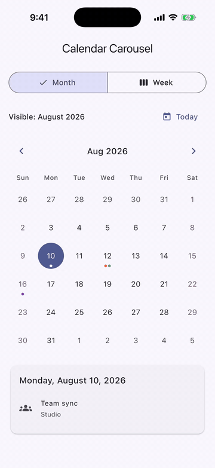

# flutter_calendar_carousel

[](https://pub.dev/packages/flutter_calendar_carousel)
[](https://github.com/hyochan/flutter_calendar_carousel/actions/workflows/ci.yml)
[](https://codecov.io/gh/hyochan/flutter_calendar_carousel)


An accessible, theme-aware Flutter calendar with lazy month and week paging,
controlled dates, typed events, and concise customization APIs.

> **Upgrading from 3.x? Version 4.0 is built on the standalone
> [`material_ui`](https://pub.dev/packages/material_ui) package** and requires
> Flutter 3.47 or later. Apps that still import `package:flutter/material.dart`
> must stay on 3.x until they migrate. See
> [Migrating from 3.x to 4.0](#migrating-from-3x-to-40).
>
> **Upgrading from 2.x?** Version 3.0 removed the 2.x compatibility layer,
> package-owned event models, and legacy styling flags. Review the
> [2.x-to-3.0 migration guide](#migrating-from-2x-to-30) first.



The example demonstrates controlled selection, event markers, and consistent
month and week navigation.

## Install

```shell
flutter pub add flutter_calendar_carousel
```

```dart
import 'package:flutter_calendar_carousel/flutter_calendar_carousel.dart';
import 'package:material_ui/material_ui.dart';
```

The package requires Dart `^3.13.0` and Flutter `>=3.47.0`, and is built on
[`material_ui`](https://pub.dev/packages/material_ui). Add it to your app if you
have not already:

```shell
flutter pub add material_ui
```

Your app must host the calendar under a `material_ui` `MaterialApp`, or under
a `Localizations` ancestor that includes `material_ui`'s Material delegates. See
[Material UI requirement](#material-ui-requirement).

## Quick start

Give the calendar a bounded height and keep selection in your widget state:

```dart
class CalendarExample extends StatefulWidget {
  const CalendarExample({super.key});

  @override
  State<CalendarExample> createState() => _CalendarExampleState();
}

class _CalendarExampleState extends State<CalendarExample> {
  DateTime _selectedDate = DateTime.now();
  DateTime _focusedDate = DateTime.now();

  @override
  Widget build(BuildContext context) {
    return SizedBox(
      height: 420,
      child: CalendarCarousel<String>.month(
        selectedDate: _selectedDate,
        focusedDate: _focusedDate,
        onDateSelected: (DateTime date, List<String> events) {
          setState(() {
            _selectedDate = date;
            _focusedDate = date;
          });
        },
        onPageChanged: (DateTime pageAnchor) {
          setState(() => _focusedDate = pageAnchor);
        },
      ),
    );
  }
}
```

Use `CalendarCarousel<T>.week(...)` for a seven-day page. Use the default
constructor with `view: CalendarView.month` or `CalendarView.week` when the view
changes at runtime.

## Selection and navigation

`selectedDate` and `focusedDate` are controlled values:

- `selectedDate` determines which day is visually selected. A tap does not
  mutate it; update it from `onDateSelected`.
- `focusedDate` requests the visible month or week. Update it for external
  navigation such as a Today button.
- `onPageChanged` reports the first day of the visible month or the configured
  first day of the visible week.

Omit `onDateSelected` to render dates without tap actions. Use `isDateEnabled`
for per-date availability, and `firstDate`/`lastDate` for the navigable range.
The default range spans 100 years before and after today's civil date.

## Application events

The calendar accepts your application model directly. Index events by local,
date-only keys and resolve them with `eventsForDate`:

```dart
class Meeting {
  const Meeting(this.title, this.color);

  final String title;
  final Color color;
}

final Map<DateTime, List<Meeting>> meetingsByDate =
    <DateTime, List<Meeting>>{
      DateTime(2026, 8, 15): const <Meeting>[
        Meeting('Release', Colors.indigo),
      ],
    };

List<Meeting> meetingsForDate(DateTime date) =>
    meetingsByDate[date] ?? const <Meeting>[];

Widget buildMeetingCalendar() => CalendarCarousel<Meeting>.month(
  focusedDate: DateTime(2026, 8, 15),
  eventsForDate: meetingsForDate,
  markerBuilder: (BuildContext context, CalendarDayDetails<Meeting> day) {
    return Align(
      alignment: Alignment.bottomCenter,
      child: Icon(Icons.circle, size: 6, color: day.events.first.color),
    );
  },
);
```

`eventsForDate` can run again during rebuilds, so keep it synchronous, pure,
and inexpensive. `CalendarDayDetails.events` and the list passed to
`onDateSelected` are immutable snapshots. A custom `markerBuilder` runs once
for each visible date with events; returning `null` hides that date's marker.

Without a custom builder, the built-in marker renders at most
`theme.marker.maxVisible` dots and an optional overflow count. Its English
semantic fallback is `1 event` or `<count> events`; localize that announcement
without replacing the visual marker:

```dart
final markerTheme = CalendarCarouselThemeData(
  marker: CalendarMarkerStyle(
    semanticLabelBuilder: (BuildContext context, int count) =>
        count == 1 ? '1 appointment' : '$count appointments',
  ),
);
```

## Configuration and theming

Related options are grouped instead of exposed as dozens of constructor
parameters:

```dart
Widget buildStyledCalendar() => CalendarCarousel<Meeting>.month(
  header: const CalendarHeaderConfig(
    enableDatePicker: true,
    showNavigationButtons: true,
  ),
  weekdays: const CalendarWeekdayConfig(
    format: CalendarWeekdayFormat.short,
  ),
  layout: const CalendarLayoutConfig(
    fixedSixWeeks: true,
    showOutsideDays: false,
  ),
  paging: const CalendarPagingConfig(axis: Axis.horizontal),
  theme: const CalendarCarouselThemeData(
    selected: CalendarDayStyle(
      backgroundColor: Colors.indigo,
      textStyle: TextStyle(color: Colors.white),
    ),
    marker: CalendarMarkerStyle(color: Colors.deepOrange, maxVisible: 3),
  ),
);
```

The day-style priority is base → weekend → outside month → with events →
`dayStyleResolver` → today → disabled → selected. Partial styles inherit
unspecified values from the ambient Material theme. Outside-month position and
styling apply only to month pages; every date in a seven-day week page reports
`CalendarMonthPosition.current`.

When `paging.viewportFraction` is below one, month pages suppress outside-month
dates even if `showOutsideDays` is true. This prevents a page and its visible
preview from rendering the same civil date twice.

Use `dayStyleResolver` for date-specific colors and shapes. Use `dayBuilder`
when the visual content itself must change:

```dart
final CalendarDayBuilder<Meeting> meetingDayBuilder =
    (BuildContext context, CalendarDayDetails<Meeting> day) {
      if (day.events.isEmpty) return null;
      return Center(
        child: Text('${day.date.day} ★', style: day.style.textStyle),
      );
    };
```

Returning `null` from `dayBuilder` keeps the default day number.

## Dates and locales

The calendar treats `DateTime` values as civil year/month/day carriers and
compares only those components. Resolver and callback values use local midnight
when it exists. If a timezone transition skips midnight but not the complete
date, Dart normalizes the value to the first representable local time (often
01:00). If a historical offset change skips the complete civil day, the
calendar uses UTC midnight as a lossless carrier for the same year, month, and
day. Always compare and index calendar data by those components rather than by
hour, instant, timezone offset, or `isUtc`.

`locale` accepts a Flutter `Locale` and defaults to
`Localizations.localeOf(context)`. Week labels, weekend detection, semantic
date labels, and header formatting follow it. The built-in picker uses that
locale when the app provides matching Material localizations and otherwise
falls back safely. `firstDayOfWeek` accepts `CalendarWeekday`; when omitted,
locale data decides.

## Material UI requirement

Flutter 3.50 deprecates the in-framework Material and Cupertino libraries in
favor of the standalone `material_ui` and `cupertino_ui` packages. Starting
with 4.0 the calendar's header buttons, tooltips, theme defaults, and built-in
date picker come from `package:material_ui`, so it reads `Theme`,
`MaterialLocalizations`, and `DatePickerThemeData` from the `material_ui`
widgets above it.

```dart
import 'package:material_ui/material_ui.dart';

MaterialApp(
  locale: const Locale('ko'),
  supportedLocales: const <Locale>[Locale('en'), Locale('ko')],
  // Includes the Material, Cupertino, and Widgets delegates.
  localizationsDelegates: GlobalMaterialLocalizations.delegates,
  home: const HomeScreen(),
)
```

`material_ui` ships localization delegates itself; you no longer need
`flutter_localizations` for the calendar's tooltips and date picker.

There is no bridge in the other direction. Hosting 4.0 under a `MaterialApp`
from `package:flutter/material.dart` fails (debug builds report
`No MaterialLocalizations found.`), and a legacy `Theme` is not inherited. If
your app has not migrated yet, keep depending on `^3.0.2`. The 3.x line uses
the in-framework libraries and can be hosted by either kind of app; under a
`material_ui` app, wrap it in `MaterialUiCompatibilityBridge`.

## Accessibility and responsive layouts

When at least one date callback is configured, each date is one accessible
button with a localized full-date label, selected state, and the available tap
or long-press actions. A calendar with no date callbacks exposes readable date
labels instead of announcing disabled buttons. `dayBuilder` and `markerBuilder`
are placed inside the date semantics. Return visual content only—do not nest a
button, gesture detector, or another interactive control. When a custom marker
conveys information not repeated elsewhere, wrap it in a non-interactive
`Semantics` label such as the localized event count.

Test custom content at the narrowest supported width and largest text scale.
The default header, weekday labels, day numbers, and overflow markers scale
down within their available bounds. Below 120 logical pixels wide, the default
header divides its width evenly between the previous, title, and next actions
so all three remain available without overflowing. On wide, low-height month
layouts, the calendar automatically raises the preferred day aspect ratio so
every week remains visible instead of clipping later rows. In severely constrained
heights, it preserves the day grid and a 24-logical-pixel budget per possible
row by hiding the header before the weekday row; custom header and weekday
content is bounded to the same layout. Below 144 logical pixels, a six-week
month cannot physically retain 24 pixels per row; with vertical page previews,
that threshold is `144 / viewportFraction`. The calendar still renders every
row without overflow. `dayPadding` only insets visuals—the complete grid cell
remains the date's hit and semantics target.

## Performance contract

- Month and week pages are generated lazily; the full configured date range is
  never materialized.
- Date arithmetic uses civil components, avoiding daylight-saving drift.
- `eventsForDate`, `dayStyleResolver`, and builders should be pure and cheap.
- The default marker does work proportional to `maxVisible`, not the total
  number of events.
- A custom marker builder is called once per event-bearing visible day build;
  bound any per-event work inside it.

## Migrating from 3.x to 4.0

4.0 changes no calendar API. Constructors, configuration objects, callbacks,
and defaults are identical to 3.0.2. The breaking change is the Material
library the package is built on.

1. Upgrade to Flutter 3.47 or later (Dart 3.13 or later).
2. Migrate your app to `material_ui`. Flutter's automated fix rewrites the
   imports and adds the dependency:

   ```shell
   dart fix --apply --code=migrate_design_widgets
   ```

   See Flutter's
   [migration guide](https://docs.flutter.dev/release/breaking-changes/material-ui-and-cupertino-ui)
   for manual steps.
3. Replace `flutter_localizations` delegates with
   `GlobalMaterialLocalizations.delegates` from `material_ui`.
4. Remove any `MaterialUiCompatibilityBridge` you added only for this calendar;
   it is no longer needed. Keep it if other dependencies still use
   `package:flutter/material.dart`.
5. Bump the dependency to `flutter_calendar_carousel: ^4.0.0`.

Types you pass to the calendar, such as `TextStyle`, `Color`, `Widget`,
`EdgeInsetsGeometry`, `OutlinedBorder`, and `ScrollPhysics`, are core Flutter
types, so existing configuration code compiles unchanged once the app imports
`material_ui`.

## Migrating from 2.x to 3.0

3.0 intentionally removes the compatibility layer. There are no deprecated
shims or model adapters.

| 2.x API | 3.0 replacement |
| --- | --- |
| `CalendarCarousel(..., weekFormat: false)` | `CalendarCarousel.month(...)` |
| `CalendarCarousel(..., weekFormat: true)` | `CalendarCarousel.week(...)` |
| `selectedDateTime` | `selectedDate` |
| `targetDateTime` | `focusedDate` |
| `onDayPressed` | `onDateSelected` |
| `onDayLongPressed` | `onDateLongPressed` |
| `onCalendarChanged` | `onPageChanged` |
| `minSelectedDate`, `maxSelectedDate` | `firstDate`, `lastDate` |
| `inactiveDates`, `disableDayPressed` | `isDateEnabled` or omit `onDateSelected` |
| String `locale` | Flutter `Locale` |
| Integer `firstDayOfWeek` | `CalendarWeekday` |
| `Event`, `EventInterface`, `EventList`, `markedDatesMap` | Application model + date-only map + `eventsForDate` |
| `MarkedDate`, `MultipleMarkedDates` | `dayStyleResolver` |
| `customDayBuilder` | `dayBuilder(context, CalendarDayDetails<T>)` |
| Marker widget/icon/overflow options, `maxDot`, `showIconBehindDayText` | `markerBuilder` and `CalendarMarkerStyle` |
| `markedDateCustomShapeBorder`, `markedDateCustomTextStyle` | `theme.withEvents` |
| Individual day/today/selected/weekend/inactive colors, text, borders, shapes, and alignment | `CalendarCarouselThemeData` and `CalendarDayStyle` |
| Header visibility, icons, title interaction, margins, callbacks | `CalendarHeaderConfig`, `CalendarHeaderStyle`, or `CalendarHeaderConfig.builder` |
| `weekDay*`, `WeekdayFormat`, `customWeekDayBuilder` | `CalendarWeekdayConfig`, `CalendarWeekdayFormat`, `CalendarWeekdayStyle` |
| `staticSixWeekFormat`, `showOnlyCurrentMonthDate`, `childAspectRatio`, `dayPadding` | `CalendarLayoutConfig` |
| `isScrollable`, `scrollDirection`, `pageScrollPhysics`, `viewportFraction` | `CalendarPagingConfig` |
| `width`, `height` | Parent constraints such as `SizedBox` |
| `pageSnapping` | Removed; calendar pages always snap |
| `customGridViewPhysics`, `shouldShowTransform` | Removed with no replacement |
| Deep imports from `classes/` | Import the package entrypoint only |

## Example app

See the [example app](https://github.com/hyochan/flutter_calendar_carousel/tree/main/example)
for controlled month/week switching, application events, custom markers,
theming, date-picker navigation, and large-text responsive behavior.

## Support

Report bugs and feature requests in the
[GitHub issue tracker](https://github.com/hyochan/flutter_calendar_carousel/issues).

If this package helps your project, you can support its maintenance through
[Buy Me a Coffee](https://www.buymeacoffee.com/dooboolab) or
[PayPal](https://paypal.me/dooboolab).

Released under the [MIT License](https://github.com/hyochan/flutter_calendar_carousel/blob/main/LICENSE).
